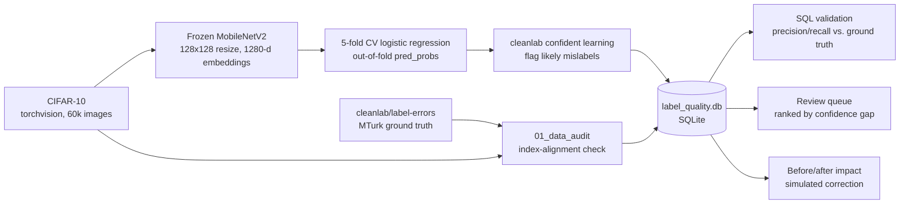

# Label Quality Analyzer

[](https://github.com/crisomara/label-quality-analyzer/actions/workflows/ci.yml)
[](https://github.com/crisomara/label-quality-analyzer/actions/workflows/security.yml)

A confident-learning QA pipeline that flags likely mislabeled CIFAR-10 images and
scores its own output against a published, human-verified answer key — a case study
in whether an automated data-quality process can actually be trusted, not just
whether it *looks* like it works.

**The question:** how do you know if your training data's labels are actually
correct, and can you trust an automated QA process to catch the bad ones?

📄 **[Read the case study](reports/case_study.md)** — full methodology, every number sourced to a notebook cell, including the parts that didn't go as expected
🖥️ **[Live demo](https://label-quality-analyzer.streamlit.app/)** — browse the flagged review queue image-by-image and see precision/recall computed live against the published ground truth

## Results

| Metric | Value | Definition |
|---|---|---|
| **Precision** (within the reviewed pool) | **20.2%** (23/114) | of flagged test images with known ground truth, how many are real confirmed errors |
| **Recall** (of all known errors) | **42.6%** (23/54) | of the 54 published, human-confirmed label errors, how many our pipeline also caught |
| Baseline classifier accuracy | 82.9% | 5-fold cross-validated logistic regression on frozen MobileNetV2 embeddings |
| Images flagged | 6,439 / 60,000 (10.7%) | `cleanlab` confident learning, full CIFAR-10 (train + test) |

**Headline findings:**
- The pipeline catches real, independently-verified label errors — but well over
  half of the known errors slip through. That's reported as a real limitation of
  this specific CPU-only pipeline, not smoothed over.
- **A more accurate baseline classifier caught *fewer* known errors, not more.** An
  earlier run at native 32x32 resolution (58.5% baseline accuracy) recovered 63%
  recall; fixing a resize bug that raised accuracy to 82.9% *dropped* recall to
  43%. Confident learning's flag rate is directly coupled to how confident the
  underlying classifier is — see the case study's "what surprised us" section.
- **Correcting a small slice of the flagged review queue didn't help** in a
  before/after retraining simulation — accuracy was flat or slightly worse for
  every correction size up to 1,000 images. Only correcting nearly the entire
  flagged training set (5,320 images) produced a clear improvement (+9.9 points on
  a confirmed-clean eval subset). At ~20% flagged-item precision, naively
  auto-accepting the model's guess for a handful of top flags isn't obviously
  better than doing nothing — a human-in-the-loop review step matters.
- The hypothesized visually-confusable class pairs (cat/dog, automobile/truck)
  really do dominate the confirmed errors — but so does an unhypothesized one,
  airplane/ship, likely driven by shared sky/water backgrounds rather than the
  object itself.

## Architecture



The analysis pipeline itself is entirely notebook-driven (`notebooks/01` through
`04`) — this is a QA/analysis case study, not a deployed prediction service.
`src/` holds the reusable loading, embedding-extraction, confident-learning, and
database code every notebook imports, so the same logic isn't copy-pasted across
notebooks. `app.py` is a separate, lightweight Streamlit demo that lets a visitor
browse the pipeline's output (the review queue and validation results) without
running any of the above themselves — see [Live demo](#live-demo) below.

## Data

- **CIFAR-10** (60,000 32x32 images, 10 classes): `torchvision.datasets.CIFAR10`,
  auto-downloaded on first run of notebook 01, ~170MB, gitignored
  (`data/raw/cifar10/`).
- **[`cleanlab/label-errors`](https://github.com/cleanlab/label-errors)**: the
  published, human-verified ground truth for CIFAR-10's test set — 275
  MTurk-reviewed candidate errors, 54 confirmed. Small (~110KB total) and
  committed directly at `data/raw/label_errors_ground_truth/` since it's the
  project's answer key, not bulk data.
- **Why CIFAR-10 over a more original dataset:** it's one of the only datasets with
  an independent, peer-reviewed, human-verified label-error answer key already
  published. Verifiability was chosen over novelty — see the case study's "the
  data" section for the full reasoning.

## Structure
```
notebooks/
  01_data_audit.ipynb              # load CIFAR-10 + ground truth, index-alignment check, class distributions
  02_embeddings_and_baseline.ipynb # frozen MobileNetV2 embeddings, resize diagnostic, cross-validated baseline
  03_confident_learning_qa.ipynb   # cleanlab flagging, near-duplicate + low-confidence checks, review queue, SQLite load
  04_validation_and_impact.ipynb   # SQL precision/recall vs. ground truth, confusion analysis, before/after impact
src/
  data_loading.py    # CIFAR-10 + ground truth loading, index alignment
  embeddings.py       # frozen MobileNetV2 embedding extraction
  qa.py               # cross-validated classifier, cleanlab wrapper, near-duplicates, review queue
  db.py                # SQLite schema + load helpers
data/
  raw/cifar10/                     # torchvision auto-download, gitignored
  raw/label_errors_ground_truth/   # published corrected labels, committed
  label_quality.db                 # SQLite, gitignored (regenerated by notebooks 03-04)
  cache/                           # intermediate parquet/npy artifacts between notebooks, gitignored
reports/
  case_study.md      # full technical writeup
  figures/           # every chart, exported from the notebooks
requirements.txt
```

## The database

`data/label_quality.db` (SQLite, regenerated by notebook 03, gitignored) has three
tables:

- **`images`** — one row per CIFAR-10 image (60,000 rows): true label, model
  prediction, confidence metrics, the confident-learning flag, and (for the 10,000
  test images) the published ground-truth review status.
- **`review_queue`** — the prioritized subset flagged by confident learning
  (6,439 rows), ranked by confidence gap, with a review category
  (`likely_mislabel` / `ambiguous` / `duplicate`) — the actual deliverable a QA
  analyst would hand to a labeling team.
- **`near_duplicates`** — candidate duplicate image pairs from embedding cosine
  similarity (0 found in CIFAR-10 at the threshold used — a real negative result).

Notebook 04's precision/recall and confusion-pair analysis runs as real SQL queries
against this database (`pd.read_sql_query` with `GROUP BY`/`CASE WHEN` aggregation),
not pandas groupbys — see `notebooks/04_validation_and_impact.ipynb`.

## Setup

```
python -m venv .venv
.venv\Scripts\activate
pip install -r requirements.txt
```

CPU-only by design — `requirements.txt` installs `torch`/`torchvision` from the
CPU wheel index. No GPU, no CUDA required. Before committing to the embeddings
approach, a bare CPU-only torch install was verified end-to-end (import, tensor
ops, a full forward pass through pretrained MobileNetV2) in a fresh venv, to avoid
repeating an out-of-memory crash hit during an earlier project's end-to-end CNN
training.

Run the notebooks in order (`01` through `04`) to reproduce everything from
scratch; each depends on cached artifacts (`data/cache/`) or the SQLite database
from the ones before it. Notebook 02 is the slow one — extracting frozen
embeddings for 60,000 images and cross-validating a classifier takes roughly
20 minutes on CPU; the rest run in a few minutes each.

## Live demo

`app.py` is a Streamlit app for browsing the pipeline's output interactively:
filter the 6,439-image review queue by class/category, inspect any flagged image
against the model's prediction, and see precision/recall — 20.2% and 42.6% — as
well as the confusion-pair and before/after-correction charts, all computed live
in the app from a bundled slice of the pipeline's real output.

It does **not** need CIFAR-10, torch, or cleanlab at runtime. It reads a small
(~20MB) precomputed bundle at `demo_assets/` (images, the review queue, and the
ground-truth join needed for validation), built once from the notebook pipeline's
cached artifacts by `scripts/build_demo_bundle.py` and committed to the repo.

Run it locally:

```
streamlit run app.py
```

To regenerate `demo_assets/` after re-running the notebooks (e.g. new embeddings
or a different classifier):

```
python scripts/build_demo_bundle.py
```

(requires `data/cache/` and `data/raw/cifar10/` populated — i.e. notebooks 01-03
already run.)

**Deployed at [label-quality-analyzer.streamlit.app](https://label-quality-analyzer.streamlit.app/)** via Streamlit Community Cloud, pointed at this repo's `master` branch with main file `app.py`. `demo_assets/` is already committed so no extra setup was needed on the hosting side.

## CI

GitHub Actions runs on every push and pull request. The notebooks are never executed in CI (they download CIFAR-10 and extract 60,000 CNN embeddings).

- **CI** (`ci.yml`): ruff over the code and notebooks (`ruff.toml`); nbformat schema validation of every notebook with sizes in the job summary; pytest with coverage for `src/qa.py` and `src/db.py`, a consistency check of `demo_assets/`, and a Streamlit `AppTest` smoke test that renders `app.py`; an offline lychee check of internal links and images on the GitHub Pages landing page, this README and the case study.
- **Security** (`security.yml`, also weekly): gitleaks over the full history, pip-audit on `requirements.txt` and `requirements-ci.txt`, CodeQL (Python), dependency review on pull requests, and actionlint.
- Dependabot opens grouped weekly updates for pip and GitHub Actions.

CI installs the light `requirements-ci.txt` (no torch/torchvision). Locally:

```bash
pip install -r requirements-ci.txt
ruff check .
pytest
```

## License

MIT — see [LICENSE](LICENSE).
